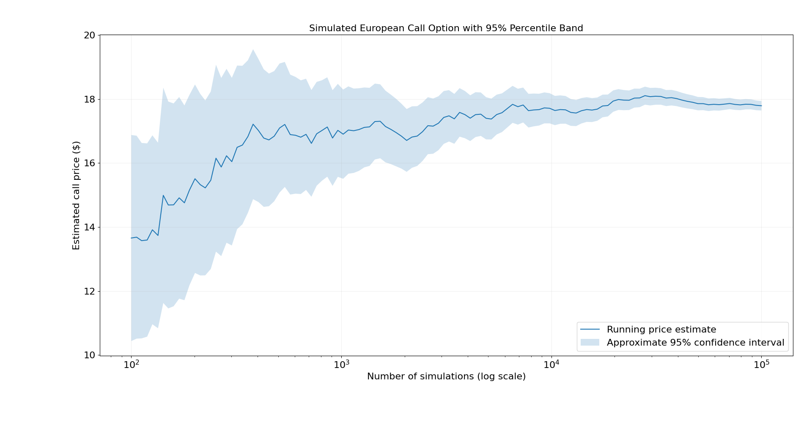

# Stochastic Modelling and Financial Models

**VaR_Monte_Carlo.py**

This file implements a Monte Carlo Value-at-Risk (VaR) model for a simple equally weighted portfolio. The portfolio consists of five exchange-traded funds (ETFs) stored in the tickers list:
- SPDR S&P 500 ETF Trust (SPY), 
- Vanguard Total Bond Market ETF (BND),
- SPDR Gold Shares (GLD),
- Invesco QQQ Trust (QQQ),
- Vanguard Total Stock Market ETF (VTI).

The model downloads historical price data, computes daily log returns and estimates the portfolio’s expected return and volatility using the historical covariance matrix. It then simulates possible future portfolio profit-and-loss outcomes over a 20-day holding period using normally distributed random shocks. 

The resulting histogram shows the distribution of simulated portfolio P&L. The red dashed vertical line represents the estimated VaR threshold. At the 95% confidence level, this is the loss level expected to be exceeded in only 5% of simulated scenarios. At the 99% confidence level, the VaR threshold moves further into the left tail, reflecting a more conservative estimate of downside risk. This provides a simple framework for estimating potential portfolio losses under historical volatility and normal return assumptions.

**Portfolio_Value_GBM.py**

This file simulates possible future portfolio value paths using a discrete-time approximation of geometric Brownian motion (GBM). At each time step, the portfolio value is updated according to

$$S_{t+\Delta t} = S_t R_t,$$

where

$$R_t \sim \mathcal{N}\left((1+\mu)^{\Delta t}, \sigma\sqrt{\Delta t}\right).$$

Here, $S_t$ is the portfolio value at time $t$, $\mu$ is the expected annual return, $\sigma$ is the annual volatility, $\Delta t$ is the time step size measured in years and $R_t$ is the random return multiplier at each time step.

The model generates multiple random walk trajectories over a fixed investment horizon, allowing us to visualise how a portfolio with initial value $S_0 = 100$ may evolve under assumed annual drift and volatility parameters.

**European_Call_Monte_Carlo.py**

The price of the underlying asset $S=S(t)$ at time $t$ is assumed to follow (risk-neutral) geometric Brownian motion, which is a continuous-time stochastic process described by the SDE 

$$dS=\mu Sdt+\sigma SdW, \quad t\in[0,T],$$

where $\mu$ is the drift, $\sigma$ is the volatility and $W=W(t)$ is a Wiener process. In plain English, we first simulate $i=1,\ldots,n$ expiry prices for the underlying asset at the terminal time $T>0$ using the solution to the above equation. Recall that a Wiener process has independent increments satisfying $W(t)-W(s)\sim N(0,t-s)$ for all $t>s\geq 0$. At expiry, $t=T$ and if $s=0$ then $W_i(T)\sim N(0,T)$. For this example, we take $T=2$ meaning $W_i(2)\sim N(0,2)$, or by normalising, $W_i(2)\sim\sqrt{2}N(0,1)$. Next, we calculate all $n$ call options using $\max(S_i(T)-K,0)$ where $K$ is the strike price (i.e. the price when the call can be exercised). We then take the mean of all such payoffs. To find the price of the option today, i.e. when $t=0$, we set $\mu=r$ and compute the product $S_i(2)\times e^{-2r}$ where $r$ is the risk-free interest rate.

The solution to the equation for geometric Brownian motion is below. It was a fun exercise. 

To derive the solution, we first let $f(s)=\ln(s)$ with $S=S(t)$ satisfying the above equation and $S(0)>0$. Using Ito's lemma, 

$$df(S)=\frac{\partial f(S)}{\partial s}dS+\frac{1}{2}\frac{\partial^2f(S)}{\partial s^2}(dS)^2,$$

or equivalently, 

$$df(S)=\left(\mu-\frac{\sigma^2}{2}\right)dt+\sigma^2dW.$$

Integrating both sides over the interval $[0,T]$ then gives

$$\int_0^Tdf(S)=\left(\mu-\frac{\sigma^2}{2}\right)\int_0^Tdt+\sigma^2\int_0^TdW$$

$$f(S(T))-f(S(0))=\left(\mu-\frac{\sigma^2}{2}\right)T+\sigma^2(W(T)-W(0))$$

$$\ln\left(\frac{S(T)}{S(0)}\right)=\left(\mu-\frac{\sigma^2}{2}\right)T+\sigma^2W(T)$$

$$S(T)=S(0)\exp\left(\left(\mu-\frac{\sigma^2}{2}\right)T+\sigma^2W(T)\right).$$
